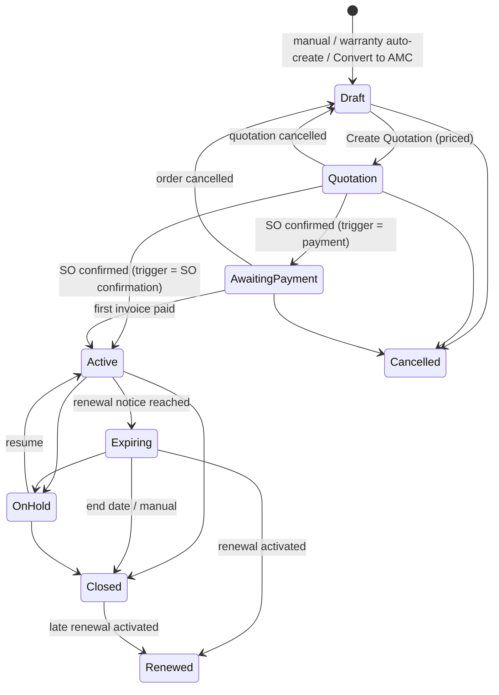

# 01 – AMC Analysis of the Original Warranty SRS

**Source:** `Warranty_Module_SRS .pdf`, "Odoo 19 Warranty Management Module – Functional Solution and
System Design Document", V1, 02 August 2026, 81 pages (read in full on 2026-11-06; text extracted
with PyPDF2; the flow diagrams on pp. 24–36, 50–51 were extracted as images and reviewed).
Page numbers below are PDF pages.

**Target:** Odoo **18** (the SRS speaks of Odoo 19; see §6).

## 1. Where AMC appears in the SRS

AMC is not confined to one chapter. Direct and indirect AMC content was found on these pages:

| SRS section | Page(s) | AMC content |
|---|---|---|
| 1. Executive summary / 1.1 objectives | 5 | AMC is a *separate but connected module*; preventive visits by AMC type (Project 2 / Retail 3 per year) |
| 1.2 Scope boundary | 5–6 | AMC service schedules kept in the AMC module and linked back to warranty; draft AMC opportunity/contract from warranty; AMC activates, prices, stages, bills and schedules in its own module |
| 2.1 Architecture | 6 | AMC must be a separate module; warranty may create/link a draft; mandatory chain Helpdesk → Service Job → Field Service; scope modes Warranty Only / Free Services / AMC / AMC with Free Services |
| 2.12 AMC as a separate module | 10 | The core AMC specification (draft creation, configuration dimensions, 9 stages, services after activation via Helpdesk chain, Subscriptions optional, 8 pricing methods, controlled expression, governance) |
| 2.14 Traceability matrix rows 11, 12, 19, 35, 40, 41 | 11–12 | AMC separation, scope modes, AMC after warranty, AMC stages, AMC by pricelist/frequency/price, AMC formula |
| 2.15 AMC Plan / Contract interface | 15 | Field list: plan, pricelist, equipment/warranty units (M2M), frequency/visit count, free services, pricing method, formula, min/max/rounding, stage, recurring plan / invoice trigger |
| 2.16 Standard basis | 16 | Subscriptions reusable for recurring billing; coverage, formula, stages, visits, free services need the AMC module |
| 3. Standard alignment | 17 | Subscriptions / separate AMC module row |
| 4. Operating model | 17 | Stage 2 "Sale / AMC contract", stage 5 "scheduled free/AMC visit", stage 6 "AMC job" |
| 5. Core objects | 18 | Service Entitlement Line represents each free service **or AMC visit** |
| 6. Menus | 18–19 | Warranty menu "AMC Contracts" (shortcut) vs. separate "AMC Management" app with Plans, Quotations, Contracts, Services and Renewals; Service Types include AMC visit |
| 7. Configuration | 20–21 | AMC Plan (Project 2/yr, Retail 3/yr), Task Creation Method, Job Creation Mode, AMC Auto-create Mode (None / Draft Opportunity / Draft Contract), AMC Pricing Method |
| 8. Feature classification | 23 | Separate AMC module = Custom + Configurable |
| 9.2 End-to-end flow (diagram) | 36 | "Free Service / AMC Schedule Created", "Create Warranty / Free Service / AMC Job" |
| 9.3 step 8 | 40 | AMC schedules created only in the AMC module after activation |
| 9.5 Eligibility | 42 | "Warranty period/usage **or linked AMC entitlement** valid" |
| Figure 8 (diagram) | 32 | Lifecycle: warranty confirmed → optional draft (or manual) → resolve configuration → pricing method → controlled formula → confirm quotation / payment → stages → AMC services → Helpdesk → Job → FSM; Subscriptions optional |
| 9.9 AMC Integration Flow | 50–52 | Diagram p. 51 (activation → read AMC type → visits → *direct* FSM tasks → technician → complete → sign-off → update status → next visit); text p. 52 (8 steps, Helpdesk chain mandatory) |
| 9.13 Status model | 59 | AMC: Draft → Quotation → Awaiting Payment → Active → On Hold → Expiring → Renewed/Closed/Cancelled |
| 10.3 Service Entitlement interface | 62–63 | Service type "AMC Visit"; due/grace dates, status, usage due, alert, merge status, Helpdesk ticket |
| 10.4 Case interface | 63 | Case type "AMC" |
| 12 #12 Scenario | 71 | **AMC conversion after warranty expiry**: Convert to AMC, link card, AMC eligibility after expiry |
| 12 #20 SLA | 72 | SLA by customer type, policy, priority **and AMC** |
| 12.1 Must-have controls | 72 | "AMC conversion after warranty expiry" |
| 13 Validations | 74 | AMC formula: approved variables/operators only; preview and version required |
| 14 Triggers | 74–75 | "Warranty expires → offer AMC conversion if configured"; "Warranty confirmed → optionally create draft AMC record" |
| 15 Reports | 75 | **AMC Visit Schedule Report**: planned, due, overdue, held, renewed visits/contracts; filters AMC type, due date, customer, site |
| 16 Access rights | 77 | **AMC User / AMC Manager** roles |
| 16.2 Formula examples | 77 | Fixed, Per Unit, Per Visit, Percentage, Tiered, Usage, Hybrid with sample figures |
| 18 Sample data | 79 | AMC Project Plan 2 visits/yr, Retail Plan 3 visits/yr |
| 19 Workarounds | 80 | AMC billing: separate module, optional Subscriptions; never stages/formulas inside the warranty card |
| 21 References | 81 | Subscriptions documentation (recurring plans, visit scheduling stays custom) |

## 2. Extracted AMC requirements (normalized)

The SRS has no requirement identifiers. The consolidated DOCX assigns stable IDs **AMC-A01 … AMC-H06**;
they are reused here because every one of them could be traced back to the pages above (verified in
`02_AMC_Requirements_Comparison.md`). Requirements found only in the SRS are added as **AMC-X0n**;
non-functional requirements as **AMC-NFR-0n**.

| ID | Requirement (normalized) | Ref. | Category | Actor | Trigger | Business rules / acceptance | Priority |
|---|---|---|---|---|---|---|---|
| AMC-A01 | AMC lifecycle, pricing, visits, renewals, billing live in a separate module, not on the warranty card | pp. 6, 10, 16–17, 80 | Technical | — | — | Separate addon; warranty card has no AMC stage/formula fields | Critical |
| AMC-A02 | General settings scope modes (Warranty Only / Free Services / AMC / AMC + Free Services) enable AMC integration | pp. 6, 11, 20 | Configuration | Admin | Setting | See gap G-01 (superseded by BA decision) | Medium |
| AMC-A03 | Warranty confirmation optionally creates/links a Draft AMC Opportunity or Draft AMC Contract | pp. 6, 10, 21, 52, 75 | Integration | System | Warranty confirmed | Draft only, never Active | High |
| AMC-A04 | AMC Auto-create Mode None / Draft Opportunity / Draft Contract | pp. 21, 52 | Configuration | Admin | Setting | Draft creation never activates coverage | High |
| AMC-A05 | Activation only by the AMC's own quotation / order / payment trigger | pp. 6, 10, 52 | Functional | System | SO confirmed / invoice paid | No activation from warranty | Critical |
| AMC-A06 | Contract covers equipment and warranty unit numbers (many per contract) | pp. 10, 15, 52 | Functional | AMC User | Contract entry | Equipment / Warranty Units M2M | High |
| AMC-A07 | Convert to AMC after warranty expiry; warranty card linked to the AMC | pp. 71–72, 75 | Integration | AMC User | Customer buys AMC | Card ↔ AMC link | High |
| AMC-A08 | After conversion, AMC eligibility (not expired warranty) applies to services | pp. 42, 71 | Integration | System | Service request | "linked AMC entitlement valid" | High |
| AMC-A09 | AMC Management menus: Plans, Quotations, Contracts, Services, Renewals; smart buttons from warranty | pp. 18–19 | UI | Users | — | Separate app | Medium |
| AMC-B01 | AMC plan master with plan identity | pp. 10, 15, 20, 52 | Functional | AMC Manager | Configuration | Named plans | High |
| AMC-B02 | Plans by customer type / pricelist; no hard-coded visit counts per customer type | pp. 10, 15, 19–20, 52 | Configuration | AMC Manager | — | Pricelist applicability | High |
| AMC-B03 | Product / equipment applicability of the plan | pp. 10, 15, 52 | Configuration | AMC Manager | — | Products / categories | High |
| AMC-B04 | Visit frequency and count (number + unit) | pp. 5, 10, 15, 20, 52 | Functional | AMC Manager | — | e.g. 3 per year | Critical |
| AMC-B05 | Project 2/yr and Retail 3/yr as examples, not fixed rates | pp. 5, 20, 51–52, 79 | Configuration | — | — | Configurable | Medium |
| AMC-B06 | Included free services on the plan; entitlements created after activation | pp. 10, 15, 19, 52 | Functional | System | Activation | Count per plan | High |
| AMC-B07 | Contract start / end criteria | p. 10 | Functional | AMC Manager | — | Not fully specified (gap G-05) | High |
| AMC-B08 | Renewal rules and Renewed contracts | pp. 6, 10, 19, 52 | Functional | AMC User | End approaching | Not fully specified (gap G-04) | High |
| AMC-B09 | Recurring billing plan + invoice trigger (sample Annual / On Payment) | pp. 10, 15 | Functional | AMC Manager | — | Billing plan on contract | High |
| AMC-B10 | Service type "AMC Visit" distinct from free / chargeable / repair | pp. 19, 62–63 | Configuration | — | — | Selection value | Medium |
| AMC-B11 | Customer / site context for entitlement and planning; site-based pricing | pp. 10, 42, 52, 75 | Functional | — | — | Site on contract / lines | Medium |
| AMC-C01 | AMC quotation step before activation | pp. 10, 19, 32, 52 | Functional | AMC User | Price agreed | Quotation | Critical |
| AMC-C02 | Stages Draft, Quotation, Awaiting Payment, Active, On Hold, Expiring, Renewed, Closed, Cancelled | pp. 10, 15, 52, 59 | Functional | System/Users | Actions | All nine | Critical |
| AMC-C03 | No AMC schedules / free-service entitlements before Active | pp. 6, 10, 40, 52 | Validation | System | — | Generated at activation | Critical |
| AMC-C04 | On Hold, Closed, Cancelled distinct states (effects to confirm) | pp. 10, 15, 52, 59 | Functional | AMC Manager | — | Gap G-06 | High |
| AMC-C05 | Expiring / Renewed states and renewal management | pp. 6, 10, 19, 52 | Functional | System | — | Gap G-04 | High |
| AMC-C06 | Manual AMC creation on customer request | pp. 32, 52 | Functional | AMC User | Request | Without warranty | High |
| AMC-C07 | Reference to source warranty card / units for continuity | pp. 6, 15, 71 | Integration | System | Conversion | Link kept | Medium |
| AMC-D01 | Pricing methods Fixed, Per Unit, Per Visit, % Equipment/Sales Value, Tiered, Site-Based, Usage, Hybrid | pp. 10, 15, 21, 77 | Functional | AMC Manager | — | 8 methods | High |
| AMC-D02 … D08 | Calculation of each method (SRS 16.2 examples) | pp. 10, 77 | Functional | System | Price calc | Examples p. 77 | High |
| AMC-D09 | Controlled expression builder, no unrestricted Python | pp. 10, 21, 74 | Security | System | — | Approved operators only | Critical |
| AMC-D10 | Allowed variables equipment_value, quantity, visit_count, contract_months, usage, site_count, factors | p. 10 | Functional | — | — | Variable list | High |
| AMC-D11 | Effective dates, version, currency, rounding, min / max | pp. 10, 15, 21 | Functional | AMC Manager | — | Versioned formulas | High |
| AMC-D12 | Sample preview; reject unapproved variables / operators | pp. 10, 21, 74 | Validation | AMC User | — | Preview | High |
| AMC-D13 | Approval for manual price override | p. 10 | Control | Approver | Override | Approval | High |
| AMC-E01 | Visit / entitlement schedule generated when Active | pp. 6, 10, 40, 51–52 | Functional | System | Activation | — | Critical |
| AMC-E02 | Counts from plan / pricelist, not hard-coded types | pp. 10, 20, 51–52 | Functional | System | — | — | High |
| AMC-E03 | Each visit = entitlement with due date, type, status, linked to contract / equipment | pp. 17–18, 52, 62–63 | Functional | — | — | Entitlement record | High |
| AMC-E04 | Due-date / usage alerts prompt job creation | pp. 8, 42, 52, 63, 75 | Automation | System | X days before | Activity | High |
| AMC-E05 | Draft job / manual / alert strategy instead of all FSM tasks at once | pp. 8, 21, 41–42, 52, 79 | Automation | — | — | Configurable | Medium |
| AMC-E06 | After completion, update status and compute next visit | pp. 51–52 | Functional | System | Completion | Next due | High |
| AMC-E07 | Consume on valid completion + sign-off; not on cancel / valid reschedule | pp. 8–9, 41–42, 52 | Functional | System | Job completed | Once | Critical |
| AMC-E08 | Due / grace / expiry / carry-forward; due / overdue / missed status | pp. 63, 70, 72, 75 | Automation | System | Daily | Configurable | Medium |
| AMC-E09 | No double merge / double consumption | pp. 63, 74 | Validation | System | — | — | Critical |
| AMC-E10 | Usage capture and validation before completion (usage plans) | pp. 7–8, 14, 63, 74 | Validation | Technician | Completion | Reading mandatory, not decreasing | Medium |
| AMC-F01 | AMC jobs via Helpdesk Ticket → Service Job → Field Service Task only | pp. 6, 8, 10, 27, 52, 74 | Integration | Coordinator | Service due | Chain mandatory | Critical |
| AMC-F02 | Pending services shown on ticket; add pending entitlement to ad-hoc request | pp. 8, 14, 19, 63, 75 | Integration | Helpdesk | Ticket created | — | High |
| AMC-F03 | Merge compatible AMC services into one job (customer/site, date, status) | pp. 8, 13–14, 19, 27, 74 | Functional | Coordinator | — | Compatibility checks | High |
| AMC-F04 | One main technician mandatory, support optional, manual assignment | pp. 8, 13, 44, 74 | Functional | Planner | Confirm job | — | High |
| AMC-F05 | One worksheet instance per product/service of a merged job | pp. 8, 14, 27, 44 | Functional | System | Job confirmed | — | High |
| AMC-F06 | Worksheet answers, uploads, customer sign-off, completion validations | pp. 8, 14, 44, 52, 74 | Validation | Technician | Completion | — | High |
| AMC-F07 | Incomplete visit: entitlement and job kept, new linked visit | pp. 8–9, 29, 75 | Functional | Technician | Not completed | Not consumed | High |
| AMC-F08 | Parts via MRF with coverage decision, issue / return | pp. 9, 31, 44, 49 | Integration | Store | Parts needed | — | Medium |
| AMC-F09 | Excluded items → customer quotation → chargeable sales | pp. 5, 9, 19–20, 42, 44, 49 | Integration | — | — | — | Medium |
| AMC-F10 | Cost / approval controls, actual costs | pp. 9, 31, 76–78 | Integration | — | — | — | Medium |
| AMC-F11 | Batch completion only with all validations | pp. 8, 23, 74 | Validation | Planner | — | — | Medium |
| AMC-F12 | SLA / escalation for AMC | pp. 19, 72 | Integration | Helpdesk | — | — | Medium |
| AMC-F13 | List / kanban / calendar / analysis views and filters for service planning | pp. 8, 19, 75–76 | UI | — | — | — | Medium |
| AMC-G01 | AMC recurring billing (Subscriptions optional) | pp. 10, 16–17, 19, 80–81 | Functional | — | — | — | High |
| AMC-G02 | Coverage / visits / formulas stay in AMC even with Subscriptions | pp. 6, 10, 16–17, 80–81 | Technical | — | — | — | High |
| AMC-G03 | Billing / activation trigger from the plan (Annual / On Payment) | pp. 10, 15, 52 | Functional | System | — | — | High |
| AMC-G04 | Quotation / SO / payment milestones as commercial trigger | pp. 6, 10, 32, 52 | Functional | System | — | — | Critical |
| AMC-G05 | Chargeable exclusions through sales quotation / invoice | pp. 5, 9, 42, 49, 71, 78 | Integration | — | — | — | Medium |
| AMC-G06 | Pricing governance governs the quoted amount | pp. 10, 15, 21 | Functional | — | — | — | High |
| AMC-H01 | AMC Visit Schedule report (planned, due, overdue, held, renewed; filters type, due date, customer, site) | p. 75 | Reporting | Users | — | — | High |
| AMC-H02 | Linked AMC visits / Helpdesk / Service Job visible from related views | pp. 18–19, 52, 62–63 | UI | — | — | — | Medium |
| AMC-H03 | AMC User and AMC Manager roles | p. 77 | Security | Admin | — | — | Critical |
| AMC-H04 | Executed visits keep links to ticket, job, FSM task, worksheet, sign-off | pp. 6, 8, 17, 52, 63–65 | Integration | — | — | — | High |
| AMC-H05 | Audit / chatter history of critical events | pp. 10, 15, 19, 77 | Audit | — | — | — | High |
| AMC-H06 | Override / material / cost / customer approvals recorded | pp. 9–10, 74, 77 | Control | — | — | — | High |
| AMC-X01 | "Warranty expires → offer AMC conversion if configured" (automation) | p. 75 (14) | Automation | System | Card expired | Activity, configurable | Medium |
| AMC-NFR-01 | Multi-company isolation and consistency | general (SRS 18 company, 2.3 compatibility) | NFR | — | — | Record rules, company checks | High |
| AMC-NFR-02 | Odoo standard reuse (Sales, Accounting, Helpdesk, FSM) over parallel workflows | pp. 16–17 | NFR | — | — | — | High |
| AMC-NFR-03 | Critical values not overwritten silently; controlled actions | p. 10 (2.13), 77 | NFR | — | — | Protected fields | High |
| AMC-NFR-04 | Odoo 18 compatibility (SRS written for Odoo 19) | p. 1 | NFR | — | — | §6 | Critical |

## 3. Reconstructed AMC lifecycle (SRS Figure 8, 9.9, 9.13)

The SRS fixes the **states** but not all **transitions**; the transitions marked with business
assumptions are listed in `03_AMC_Gap_and_Conflict_Register.md` (AS-01 … AS-08) and were approved
by the user on 2026-11-06 ("conservative documented defaults").

## 4. Requirements hidden in other chapters

* **Service Entitlement (10.3)** – AMC visits share the entitlement concept (due date, grace,
  status, merge status, Helpdesk ticket). Implemented as `amc.contract.visit` in the AMC module (the
  warranty entitlement model requires a warranty card, AMC contracts may have none).
* **Eligibility (9.5)** – "linked AMC entitlement valid" → AMC eligibility for AMC cases.
* **Case type AMC (10.4)** and service type AMC Visit (10.3) – already present in the warranty
  modules; reused.
* **SLA (12 #20)** – SLA "by AMC" → Helpdesk SLA policies on an AMC ticket tag.
* **Triggers (14)** – draft AMC on warranty confirmation; AMC offer on warranty expiry.
* **Validations (13)** – AMC formula variables/operators; service merged once; batch completion.
* **Access (16)** – AMC User / AMC Manager.

## 5. AMC-related figures

* p. 32 Figure 8 confirms the Helpdesk → Job → Field Service route for AMC jobs and optional
  Subscriptions.
* p. 51 diagram shows FSM tasks created **directly** after scheduling – superseded by the later text
  (p. 52 step 5) and the mandatory chain (pp. 6, 8). Recorded as conflict C-02.
* p. 36 end-to-end flow treats AMC jobs like free-service jobs after eligibility.

## 6. Odoo 19 → Odoo 18 compatibility

| SRS (Odoo 19) | Odoo 18 equivalent used |
|---|---|
| Subscriptions for recurring AMC invoices (optional) | Not used (user decision 2026-11-06): AMC billing schedule releasing delivered quantities on standard `sale.order.line` (manual service, invoice on delivery) + standard invoicing |
| Helpdesk after-sales / FSM from tickets | Odoo 18 Enterprise `helpdesk`, `industry_fsm`, `helpdesk_fsm` (installed) via the existing warranty Service Job |
| Field Service worksheets / sign-off | Odoo 18 `worksheet` / `industry_fsm_report` (`worksheet_signature`) via `warranty.job.worksheet` |
| Activities, chatter | `mail.activity.mixin`, `_message_log` (Odoo 18) |
| View syntax | Odoo 18 `<list>`, `invisible=` expressions, `<chatter/>`, `<setting>` blocks |
