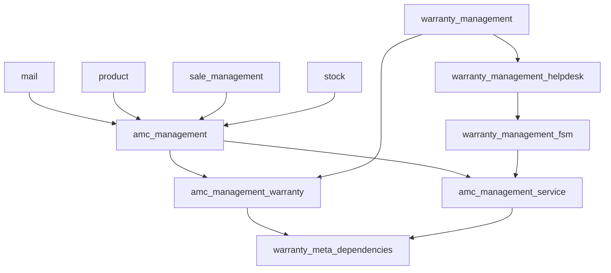

# 07 – Dependency and Impact Analysis

## 1. Module dependency graph (after 1.1.0)

* `amc_management` still depends only on mail / product / sale_management / stock (standalone).
* No warranty module depends on any AMC module. No circular dependency.
* `warranty_management_accounting` reads `sale.order.amc_contract_id` defensively
  (`'amc_contract_id' in orders._fields`) to exclude AMC orders from warranty provisions – unchanged.

## 2. Shared models touched

| Shared model | Module | Change | Scope guard | Non-AMC impact |
|---|---|---|---|---|
| `sale.order` | amc_management (1.0.0) | create / write / copy / confirm / cancel guards | `amc_contract_id` set | None (TC-070) |
| `sale.order` `action_confirm` | amc_management 1.1.0 | AMC side effect with sudo | AMC orders only | None (TC-070) |
| `sale.order` `_action_cancel` | amc_management 1.1.0 | refuse cancel for activated contracts | AMC orders only | None |
| `sale.order.line` | amc_management (1.0.0) | lock AMC lines | AMC orders only | None |
| `account.move` `_invoice_paid_hook` | amc_management 1.1.0 | activate Awaiting Payment contract | invoices with lines of AMC orders | None (TC-072) |
| `res.company` / `res.config.settings` | all | new fields | — | None |
| `warranty.card` `action_confirm_warranty` | amc_management_warranty | optional draft AMC after super; savepoint, never raises | mode ≠ None | None with mode None (TC-080, TC-083) |
| `warranty.card` `_warranty_apply_expiry` | amc_management_warranty | optional activity after super | setting on, card newly expired | None when off |
| `warranty.unit` | amc_management_warranty | helper `_amc_serial` | — | None |
| `warranty.case` `_warranty_run_checks` | amc_management_service | AMC eligibility | `case_type == 'amc'` **and** `amc_contract_id` | None (TC-097) |
| `warranty.case` `write` | amc_management_service | release AMC visits on rejected / closed | cases with AMC visits | None |
| `warranty.service.job` `action_confirm_job`, `_warranty_worksheet_lines`, `_warranty_create_worksheets`, `_warranty_visit_completion_problems`, `_warranty_complete_case`, `_warranty_cancel` | amc_management_service | AMC visit status, worksheets per visit, consumption | jobs whose case has an AMC contract | None (regression suites) |
| `helpdesk.ticket` | amc_management_service | computed pending AMC visits | — (read-only compute) | None |

## 3. High-risk side effects and mitigations

| Risk | Mitigation | Verified by |
|---|---|---|
| Warranty confirmation fails because of AMC auto-create | savepoint + log, warranty confirmed anyway | TC-083 |
| AMC consumption half-applied after job completion | consumption inside `_warranty_complete_case` (inside the completion savepoint) | TC-090, TC-091 |
| Invoice-paid hook on regular invoices | filtered on AMC orders | TC-072 |
| Duplicate entitlements / billing on repeated activation | generation idempotent + row lock (`_amc_lock`) | TC-011 |
| Duplicate releases by the scheduler | release only `planned` lines; one savepoint per contract | TC-031, TC-024 |
| Helpdesk users without AMC rights on AMC cases | read-only ACL for Helpdesk / FSM users in the service bridge; writes through sudo | TC-090 |
| Migration of 1.0.0 data | post-migrate, re-runnable, no state / price changes | `21_AMC_Installation_and_Upgrade_Test_Report.md` |
