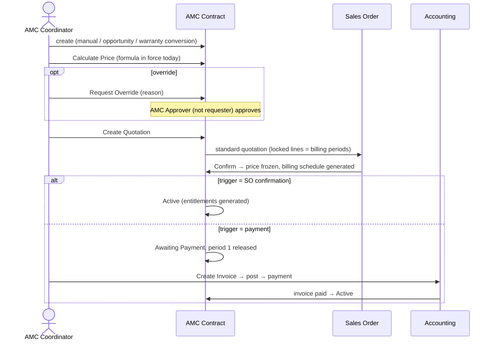

# 09 – AMC Functional Design Specification (as implemented, 18.0.1.1.0)

## 1. Functional architecture

**Objective:** sell, activate, schedule, execute, bill and renew Annual Maintenance Contracts in a
module separate from the warranty card (SRS 2.1 / 2.12), executed through the warranty solution's
mandatory Helpdesk → Service Job → Field Service chain.

| Functional module | Module | Main objects |
|---|---|---|
| Configuration | amc_management | AMC Plans, Pricing Formula versions, Billing Plans, Settings |
| Sales | amc_management | Opportunities, Contracts (Draft / Quotation / Awaiting Payment), Override Requests, Quotations (`sale.order`) |
| Contract operations | amc_management | Active / On Hold / Expiring / Renewed / Closed, Renewals, billing schedule |
| Services | amc_management (+ service bridge) | AMC Visits (preventive visits + included free services) |
| Warranty link | amc_management_warranty | Auto-create, Convert to AMC, warranty units, expiry offer |
| Execution | amc_management_service | Service request → ticket → AMC case → Service Job → FSM visit → consumption |
| Reporting | amc_management | AMC Visit Schedule (pivot / graph / list / kanban / calendar, PDF) |

**Roles** (SRS 16): AMC User, AMC Coordinator, AMC Manager, AMC Approver; Helpdesk users, Field
Service technicians and accountants keep their standard roles.

## 2. Workflows

### W1 – Configure (AMC Manager)
Plan: name, applicability (pricelists = customer types, products, categories), service basis
(period: N visits per month/year; usage: every X units), visit count, included free services,
planning mode (Alert-Driven / Manual), alert / grace days, Missed after grace, billing plan, start
criteria, duration, renewal rule + notice days, activation trigger. Pricing: formula version (method,
parameters, factors, tiers, min / max, rounding, effective dates), Activate. Validations: counts ≥ 0,
visits fit the duration, Per Preventive Visit billing needs SO-confirmation activation.

### W2 – Sell (Coordinator)

### W3 – Plan and execute a visit
1. Daily scheduler: due indicator (Upcoming / Due / Overdue), alert activity *Alert Days* before
   the due date (Alert-Driven plans, contract Active / Expiring), Missed after grace (if set).
2. Coordinator selects compatible Pending visits (same contract and site) → **Create Service
   Request** → Helpdesk ticket (new, tag AMC, or an existing ticket of the customer) + warranty case
   of type AMC → visits Scheduled.
3. Helpdesk: Check Eligibility (AMC rules: contract Active / Expiring, ticket date inside coverage,
   visits open) → Approve Case → Prepare Service Job → plan (date, main technician, support
   technicians) → Confirm → Field Service visit + one worksheet per AMC visit → visits In Progress.
4. Technician: timer, worksheet (usage reading for usage-based visits), customer sign-off →
   Complete Visit → job / case Completed, AMC visits **Completed (consumed once)**, next visit
   due date moves on, Per-Visit billing period released.
5. Not completed: standard reschedule / follow-up keeps the job and the AMC visits (not consumed).
   Cancel Job: visits back to Scheduled on the Approved case. Case Rejected / Closed: visits back to
   Pending.

Without the service bridge, the Coordinator plans (Planned Date) and completes visits manually
(Complete wizard with date, notes, usage reading).

### W4 – Lifecycle
| From | To | Trigger | Permission | Validation | Side effects |
|---|---|---|---|---|---|
| Draft | Quotation | Create Quotation | Coordinator + Salesman | priced today, billing plan, no open quotation / override request | SO created |
| Quotation | Draft | SO cancelled | Sales | — | billing lines removed |
| Quotation | Active | SO confirmed (trigger SO) | Sales (sudo side effect) | open quotation of the contract | billing schedule, entitlements, due periods released |
| Quotation | Awaiting Payment | SO confirmed (trigger payment) | Sales | — | billing schedule, period 1 released |
| Awaiting Payment | Active | invoice of the AMC order paid | Accounting (sudo) | — | as above |
| Draft / Quotation / Awaiting Payment | Cancelled | Cancel (reason) | Manager | no posted invoice | SO cancelled, billing cancelled |
| Active / Expiring | On Hold | Put On Hold (reason) | Manager | — | no alerts / planning / requests |
| On Hold | Active (→ Expiring) | Resume | Manager | end date not passed | expiring re-checked |
| Active | Expiring | scheduler: end − notice days | system | — | activity; Auto Offer → renewal draft |
| Active / Expiring / On Hold | Closed | Close (reason) / scheduler after end | Manager / system | — | open visits Expired, planned billing Cancelled |
| Running / Closed | Renewed | renewal activated (after end) / end date with active renewal | system | — | open visits Expired |
| Running / Closed | (new Draft) | Renew | Coordinator | one open renewal, plan active | linked renewal, start = end + 1 |

Repeat execution: every transition checks the current state; generation of visits / billing is
idempotent; the scheduler releases only *planned* periods and alerts only visits without alert.

## 3. Business rules (catalog)

| ID | Rule | Source |
|---|---|---|
| BR-01 | Entitlements exist only from activation | SRS p. 10, C03 |
| BR-02 | Preventive visits per covered unit = Visit Count; due every 12 / frequency months from the start, last capped at the end date; usage plans: usage due = n × interval | E01, E02, B5a |
| BR-03 | Included free services per covered unit, on demand, no due date | B06 |
| BR-04 | Covered quantities are whole units; a serial line covers quantity 1; a serial / warranty unit is on one open contract only (except predecessor / renewal) | E01, E09 |
| BR-05 | An entitlement is consumed once, by a valid completion inside the coverage period of a running contract; cancelled / rescheduled visits are not consumed | E07, E09 |
| BR-06 | Usage-based visits need a usage reading > 0 that is not lower than the last reading of the unit | E10 |
| BR-07 | Activation only by SO confirmation or payment of the first billing period | A05, G03 |
| BR-08 | Running contracts are closed, never cancelled | AS-02 |
| BR-09 | On Hold blocks planning / requests / alerts; no date extension; billing continues | AS-03 |
| BR-10 | Renewal = new linked contract priced again; predecessor Renewed at / after its end | AS-04, AS-06 |
| BR-11 | Closure expires open entitlements and cancels unreleased billing periods | AS-05 |
| BR-12 | Billing periods = quotation quantities; advance on period start, arrears on period end, per visit at consumption; released once | B09, G01 |
| BR-13 | A plan restricted to pricelists / products / categories applies only to those | B02, B03 |
| BR-14 | Price formulas: approved operators / variables only; Active versions immutable | D09–D11 |
| BR-15 | Overrides approved by an AMC Approver who is not the requester | D13 |
| BR-16 | AMC service requests combine Pending visits of one running contract and one site | F03 |
| BR-17 | With the service bridge, AMC visits are consumed only by Service Job completion with customer sign-off (when the company requires it) | F01, F06 |

## 4. User interface

| Menu path | Action / model | Views | Key buttons |
|---|---|---|---|
| AMC Management > Sales > Opportunities | `amc.opportunity` | list, form | Offer Sent, Won (Create Contract), Lost |
| … > Sales > Contracts | `amc.contract` | list, form, search (Draft, Quotation, Active, Expiring, On Hold, Closed / Renewed, Renewal Contracts, End Date; group by Status, Plan, Customer) | Calculate Price, Request Override, Create Quotation, Reissue, Create Invoice, Put On Hold, Resume, Close, Renew, Cancel, Print Visit Schedule; smart buttons Quotations, Invoices, AMC Visits, Renewals, Warranty Cards |
| … > Sales > Quotations | contracts in Quotation / Awaiting Payment | list, form | — |
| … > Sales > Override Requests | `amc.price.override` | list, form | Approve, Reject, Cancel |
| … > Sales > Renewals | Expiring contracts + renewal contracts | list, form | — |
| … > Services > AMC Visits | `amc.contract.visit` | list, kanban, calendar, form, pivot, graph; filters Open, Planned, Due, Overdue, Missed, Completed, Preventive, Free, Contract On Hold / Renewed / Running, Due Date; group by Plan, Customer, Site, Contract, Status, Due Month | Complete (core) / Create Service Request (service bridge), Reopen, Cancel |
| … > Reporting > AMC Visit Schedule | same model, pivot first | pivot, graph, list, kanban, calendar | — |
| … > Configuration | Settings, AMC Plans, Pricing Formulas, Billing Plans | — | Activate, New Version, Archive, Price Preview |
| Warranty card form | — | — | Convert to AMC, AMC smart button |
| Helpdesk ticket form | Pending AMC Services tab | — | Add AMC Services to this Ticket |
| Warranty case / Service Job forms | AMC / AMC Visits tab | — | — |

Statusbar: Draft, Quotation, Awaiting Payment, Active, Expiring, Closed (others shown when reached;
ribbons On Hold / Renewed). Validation messages name the record and the failing rule.

## 5. Reports

**AMC Visit Schedule** (SRS 15). Audience: AMC coordinators / managers. Source:
`amc.contract.visit`. Filters: AMC type (plan), due date, customer, site, status, due indicator,
contract On Hold / Renewed. Grouping: plan × due month × status. Output: pivot / graph / list /
calendar (export via standard list export) and the per-contract PDF *AMC Visit Schedule*
(`amc_management.action_report_amc_visit_schedule`). Permission: AMC User (read).
