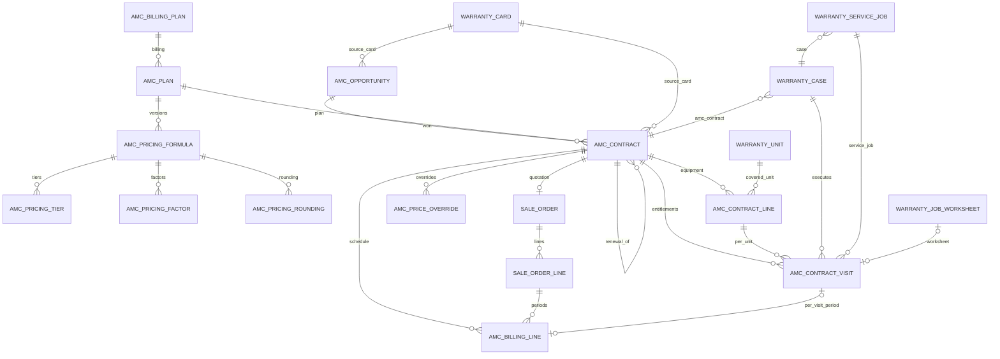

# 11 – AMC Data Model and ERD

## New / changed fields (1.1.0)

### `amc.contract.visit` (new, `_inherit` mail.thread, mail.activity.mixin)

| Field | Type | Relation | Req. | Default | Compute / store | Purpose |
|---|---|---|---|---|---|---|
| name | Char | — | yes | sequence AMCV/ | — | reference |
| contract_id | M2O | amc.contract (cascade) | yes | — | — | parent |
| line_id | M2O | amc.contract.line (cascade) | yes | — | — | covered equipment |
| company_id, partner_id, commercial_partner_id, plan_id, contract_state, product_id, serial_id | related | — | — | — | stored (indexed) | filters, rules |
| site_id | M2O | res.partner | — | — | stored compute (line / contract site / customer) | site |
| visit_type | Selection preventive / free_service | — | yes | — | — | entitlement type |
| sequence_no / sequence_total / unit_no | Integer | — | — | 1 | — | "Visit 2 of 3", unit |
| due_date / usage_due / usage_unit | Date / Float / Sel | — | — | — | — | schedule |
| alert_date / grace_end_date | Date | — | — | — | stored compute | monitoring |
| scheduled_date | Datetime | — | — | — | — | planning (writable while open & running) |
| state | Selection pending / scheduled / in_progress / completed / missed / expired / cancelled | — | yes | pending | — | lifecycle |
| due_status | Selection upcoming / due / overdue | — | — | — | written by actions / cron | indicator |
| alert_sent, alert_activity_id | Bool / M2O mail.activity | — | — | — | — | duplicate prevention |
| completion_date, completed_by_id, usage_reading, consumption_source | Date / M2O / Float / Char | — | — | — | — | evidence |
| cancel_reason, note | Text | — | — | — | — | audit |

SQL constraint `UNIQUE(contract_id, line_id, visit_type, unit_no, sequence_no)`.
Bridge (`amc_management_service`): `warranty_case_id`, `helpdesk_ticket_id` (related, stored),
`service_job_id`, `task_id`, `worksheet_id`.

### `amc.billing.line` (new)

| Field | Type | Purpose |
|---|---|---|
| contract_id (cascade), company_id, partner_id (stored related) | M2O | parent, rules |
| sequence | Integer | period number |
| sale_line_id (restrict) | M2O sale.order.line | invoiced through this line |
| amount | Monetary | untaxed period amount |
| date, period_start, period_end | Date | billing date (advance = start, arrears = end) |
| visit_id | M2O amc.contract.visit | Per Preventive Visit period |
| state | planned / released / cancelled | release once |
| released_date | Date | audit |
| invoiced | Boolean (compute) | rank ≤ `qty_invoiced` |

### `amc.contract` (added)
`contract_months` (stored snapshot), `expected_usage`, `visit_ids`, `visit_count`,
`preventive_total/done/balance`, `free_total/used/balance` (stored computes), `next_visit_date`
(stored, indexed), `billing_line_ids`, `invoice_count`, `hold_reason`, `hold_date`,
`hold_previous_state`, `expiring_date`, `close_reason`, `close_date`, `renewal_of_id`
(restrict, indexed), `renewal_ids`, `renewal_count`. Bridge: `source_warranty_card_id`,
`warranty_card_ids` (stored M2M compute).

### `amc.plan` (added)
`visit_planning_mode` (alert / manual), `grace_days`, `auto_mark_missed`, `renewal_notice_days`.

### Others
`amc.contract.line.warranty_unit_id` (bridge), `amc.opportunity.warranty_card_id` (bridge),
`res.company.amc_auto_create_mode`, `amc_offer_on_warranty_expiry` (bridge), `warranty.case.
amc_contract_id` / `amc_visit_ids`, `warranty.service.job.amc_contract_id` (stored related) /
`amc_visit_ids`, `helpdesk.ticket.amc_pending_visit_ids` / `_count` (non-stored computes).

Company handling: every new model carries `company_id` (stored related) with a record rule;
cross-company links are refused by constraints (plan / contract, unit / contract, case / contract).
