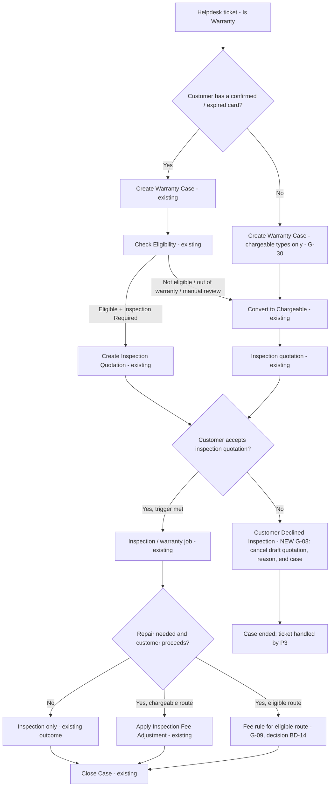
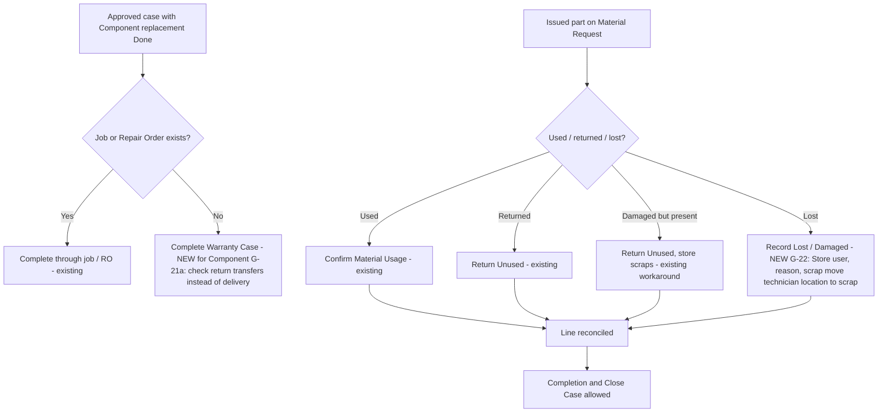
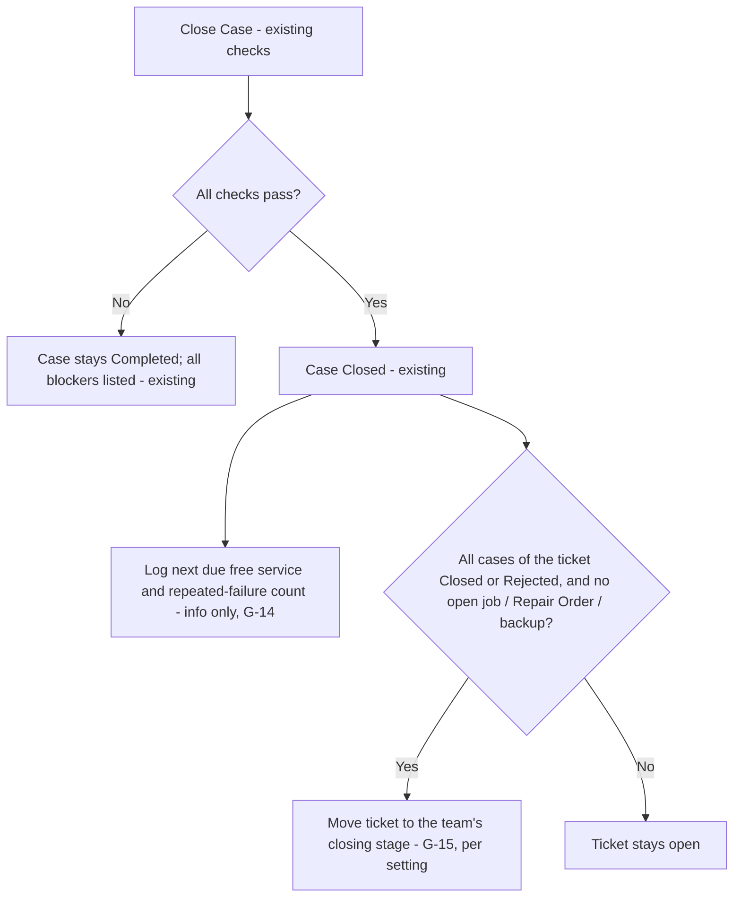
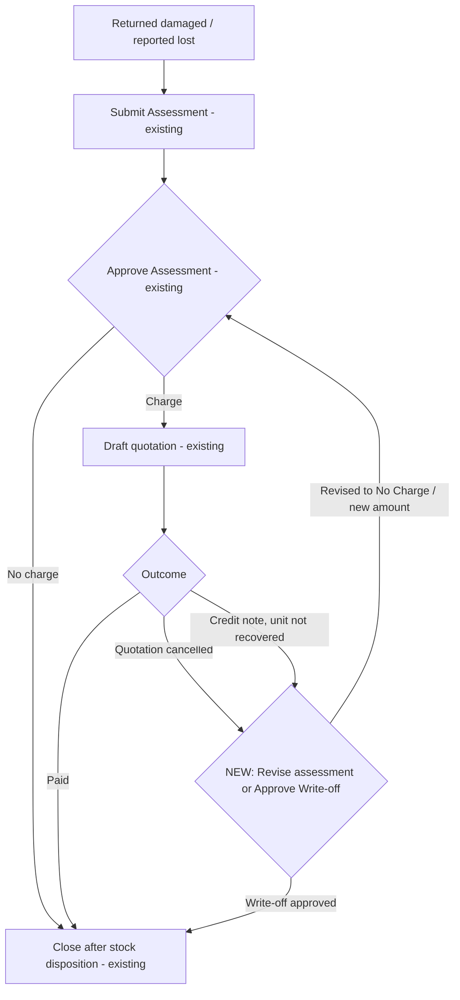
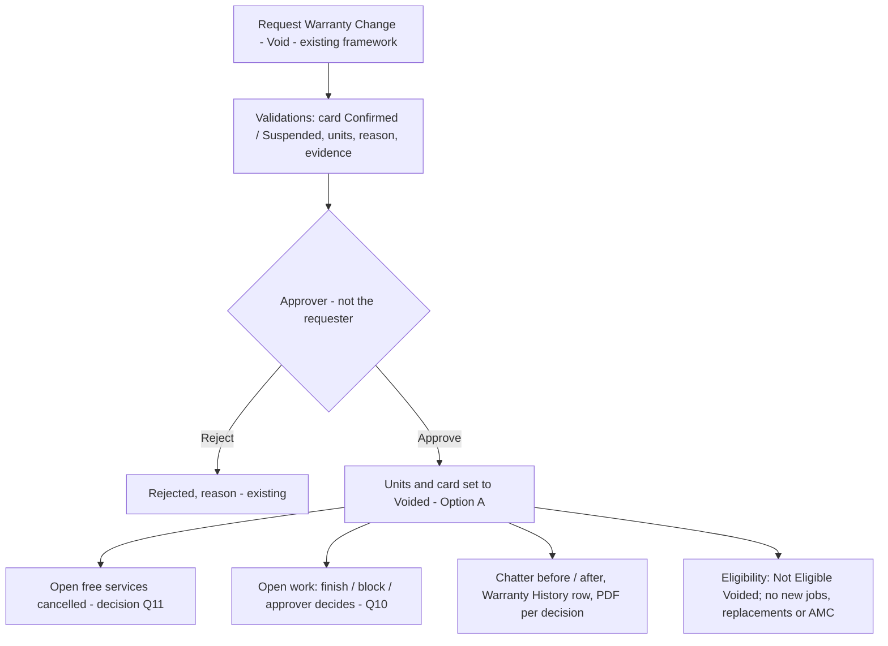

# Warranty Management – Gap Review, Phase I Functional Design and Decision List

Version 0.1 – 11 November 2026 – **for review only. Nothing here is approved for implementation.**

Basis: `01_SRS_Coverage_Matrix.md` v0.2, `02_SRS_Gap_Analysis_and_Decision_Register.md` v0.2, and a read-only code study of the current modules (identical to UAT, 11 Nov 2026). Code references are relative to `custom_addons/warranty/`. **No code, database, server or AMC file was changed.** All findings come from reading the code; none was run in the UI (that happens on `wt_manual` after approval).

---

## Part 1 – Complete gap review (26 unique gaps)

Each gap is counted once (section 9 of the register maps all 45 affected matrix rows). ⛔ = workflow blocker. Abbreviations:
- **HD** = warranty_management_helpdesk
- **FSM** = warranty_management_fsm
- **MRF** = warranty_management_mrf
- **REP** = warranty_management_repair
- **ACC** = warranty_management_accounting
- **CORE** = warranty_management
- **DASH** = warranty_management_dashboard

### 1.1 Fig 1 / Fig 2 / 9.3 / 9.10 – Sales Order, warranty card, card output

| ID | Functionality | SRS / figure | Expected (SRS) | Current | Missing | Business impact | Modules | Depends on | Priority | Pending decision | Recommended solution |
|---|---|---|---|---|---|---|---|---|---|---|---|
| G-01 ⛔ | Extended warranty product | 2.4, 2.14 #9, 12 #13, 14 | A service product on the SO extends identified units, adds free services, warns on overlap, stays linked to SO / invoice | Only the manual controlled action **Extend Warranty** (approval, quotation / invoice link) | Product configuration, allocation to units, trigger, extension record, draft free services | Paid extensions are entered by hand; no revenue link | CORE (+ ACC) | Finance Q23; Q22 maximum | High | Q21 build / defer; **Finance Q23** | Standard service product; reuse the Extend Warranty action as the engine and the existing free-service generator |
| G-03 | Pending Payment status, activation on payment | 12 #2, 14, 10.2 | Card Pending Payment → Active when the invoice is paid | Card stays Draft ("Invoice payment" missing); manual Confirm Warranty after payment | Status and automatic activation | Revenue is protected; naming and automation differ | CORE | – | Medium | Q26 | Standard invoice `payment_state`; computed status, or auto-confirm like installation |
| G-04 | Card sharing by WhatsApp / portal | 9.3 #11, 9.10, 10.8, 11 #7 | E-mail, WhatsApp link, portal; updated copy shared after replacement | Send to Customer (e-mail) and Download PDF only; Generate Updated Card does not send | Portal page, WhatsApp, send after replacement | Customers can't fetch the card themselves | CORE, REP | G-10 | Medium | Channels; WhatsApp licence | Standard portal.mixin + Share wizard; Odoo WhatsApp app only if licensed |
| G-16 | SO smart buttons | 2.3, 6, 2.14 #8 | Cards, units, services, tickets, jobs | Cards, Unit Warranties, Warranty History | Services, tickets, jobs | Extra navigation | CORE, HD, FSM | – | Low | – | Standard stat buttons |
| G-27 | Card statuses / filters | 9.13, 10.2 | Pending Payment, Voided; status filters | No such statuses; no Suspended / Cancelled filter | Statuses (from G-02 / G-03), two filters | Reporting | CORE, DASH | G-02, G-03 | Low | Via Q7 / Q26 | Search filters |

### 1.2 Fig 3 / 9.4 – Free services

| ID | Functionality | SRS / figure | Expected | Current | Missing | Impact | Modules | Depends on | Priority | Pending decision | Recommended |
|---|---|---|---|---|---|---|---|---|---|---|---|
| G-11 | Task creation method; usage-based draft jobs | 7, 9.4 diagram | Immediate / X days / Manual; usage services also get jobs | X days (draft job at alert date) and Manual. Immediate excluded (E1). Usage services never get a draft job (E9) | Usage-based draft job (Immediate only if wanted) | Usage warranties rely on To-Do alerts | FSM | – | Medium | Keep Immediate excluded?; E9 | Reuse the draft-job generator from the usage alert |
| G-12 | Carry-forward of missed services | 12 #6, #23 | Configurable carry-forward | Grace / missed / auto-expire; Late Service Exception (BA addition) | Carry-forward rule | Low (substitute exists) | CORE | – | Low | Accept Late Service Exception as substitute? | Accept the substitute, or add a policy option |
| G-17 | Services kanban | 2.5 | Kanban view | List, form, calendar; pivot / graph in reports | Kanban | Convenience | CORE | – | Low | – | Standard kanban by status |

### 1.3 Fig 4 / 9.5 / 9.7 / Suppl. Fig 2 – Helpdesk, eligibility, inspection

| ID | Functionality | SRS / figure | Expected | Current | Missing | Impact | Modules | Depends on | Priority | Pending decision | Recommended |
|---|---|---|---|---|---|---|---|---|---|---|---|
| G-08 ⛔ | Customer declines inspection quotation | 9.7 diagram, Fig 4, 2.11 | "Customer approves? No → Close Request" | No action. Case stays Approved (Fig 4) or Chargeable; Reject needs Eligibility Checked, Close needs Completed → **case can never end**; linked free services stay held | Decline action that ends the case | Cases stay open indefinitely; KPIs overstated | HD, FSM | G-15, G-10 | **Critical** | BD-14 | Package P1 (Part 2) |
| G-09 | Inspection fee on an eligible case | Fig 4, 2.11, 17 | Fee credited / deducted when the customer proceeds | Credit / deduction only on the chargeable route. On the Fig 4 route the warranty job has no repair quotation, so the fee stays charged (WCAS/000050, 1,500) | Rule for the eligible route | Overcharge / dispute | ACC, FSM | G-08 | High | BD-14 | Package P1 |
| G-30 ⛔ | Customer without any warranty card | 9.5 row 1, Suppl. Fig 1 / 2 | "Card not found → chargeable inspection or manual review" | Create Warranty Case refused without a Confirmed / Expired card (`HD helpdesk_ticket.py:153-167`); ticket product list empty | Cardless chargeable case | Non-warranty customers cannot use the 9.7 / Rs. 850 flow | HD, FSM (history: CORE, ACC, MRF, REP) | G-08 | **Critical** | BD-15 | Package P1 |
| G-26 | Existing ticket / case detection | 9.5, 13 | Warn when the serial already has an open ticket / case | One open case per free service; "Duplicate Complaint" reason | Warning banner | Duplicate handling | HD | – | Medium | – | Computed banner, no new model |
| G-13 | Repeat window, reopen | 12 #22, 12.1 | Reopen or repeat; configurable window | Repeat Complaint creates a linked case; no window | Window setting and warning | Fairness of entitlement use | HD | – | Medium | Q24 / Q25 | Company setting + warning |
| G-06 | Warranty SLA | 6, 12 #20, 2.6 | SLA by customer type / policy / priority, breach escalation | Standard Helpdesk SLA not configured or shown | SLA set-up and display | No measurable commitment | HD (config of standard helpdesk) | G-07 | Medium | Targets | Configure standard SLA Policies; show deadline on the case |

### 1.4 Fig 5 / 9.6 / 9.11 – Field Service, notification, closure

| ID | Functionality | SRS / figure | Expected | Current | Missing | Impact | Modules | Depends on | Priority | Pending decision | Recommended |
|---|---|---|---|---|---|---|---|---|---|---|---|
| G-07 | Unresolved job escalation | 12 #21 | Jobs open > N days → manager / GM activity | Not implemented | Setting, scheduled action, activity | Stuck jobs invisible | FSM | G-06 | Medium | Threshold, recipients | Standard cron + activity |
| G-10 | Customer notifications | 2.8, 2.11, 12 #16 / #19, 9.8 #5, Fig 5 | Customer notified (inspection / parts quotation, reschedule, backorder) | Internal To-Dos; manual Send of quotations | Templates and send points | Manual communication | HD, FSM, MRF | – | High | BD-18 | Standard mail templates, Helpdesk stage templates, Sales "Send by Email" |
| G-14 | Closure re-checks | 9.11 | Check repeated failure, calculate next service at closure | Repeated failure only at eligibility; no next-service display | Information at closure | Low | ACC | G-15 | Low | Info only or blocking? | Read-only log line at Close Case |
| G-15 | Helpdesk ticket closure | Fig 6 end, 9.11 | Close Helpdesk with job and repair | Ticket stays open (one ticket can hold several cases) | Ticket close when its last case ends | Manual step; open-ticket KPIs | HD, ACC | G-08, G-14 | Medium | Automatic vs prompt | Package P3 |

### 1.5 Fig 6 – Workshop repair and backup

| ID | Functionality | SRS / figure | Expected | Current | Missing | Impact | Modules | Depends on | Priority | Pending decision | Recommended |
|---|---|---|---|---|---|---|---|---|---|---|---|
| G-20 ⛔ (exception) | Backup damage / loss closure | Fig 6, 2.9, 17 | Lost / damaged → approval + quotation / invoice → close | Assessment, approval, draft quotation, found / restore / scrap, Close implemented. **Unit can never be closed when the quotation was cancelled or a credit note was issued and the unit was not recovered**; Closed Lost unit cannot be recovered | Write-off path; recovery of closed lost unit; second damage charge; deposit; cost link; loan rules | Records stuck open (does **not** block Close Case) | REP (ACC) | P3 if it should block Close Case | High | BD-16 | Package P4 |

### 1.6 Fig 7 / 9.8 – Material Requests

| ID | Functionality | SRS / figure | Expected | Current | Missing | Impact | Modules | Depends on | Priority | Pending decision | Recommended |
|---|---|---|---|---|---|---|---|---|---|---|---|
| G-22 ⛔ (exception) | Lost / damaged issued spare part | 2.10, Fig 7 | Unused parts returned, consumption reconciled | No way to record a lost covered part in the technician location (K-8 deferred). It blocks **job completion**, every completion path and MRF close. A standard scrap does not reconcile the line. Workaround: a damaged part that still exists can go Return Unused → store scrap | Controlled "Record Lost / Damaged" | Case never reaches Completed | MRF | P2 | Medium | BD-34f | Package P2 |

### 1.7 SRS 11 / Suppl. Fig 3 – Replacement

| ID | Functionality | SRS / figure | Expected | Current | Missing | Impact | Modules | Depends on | Priority | Pending decision | Recommended |
|---|---|---|---|---|---|---|---|---|---|---|---|
| G-21 ⛔ (a) | Replacement completion and approvals | 11, 11.2, 16.1, Suppl. Fig 3 | Close case after any replacement; high-value = GM + Finance | (a) **Component replacement case with no job / Repair Order has no completion path** (`REP warranty_case.py:244-249`). (b) "High value" Finance threshold undefined (B1). (c) Component PDF already regenerated in code; R5 record still says "BA to choose". (d) Generate Updated Card untested | (a) completion, (b) threshold | (a) case stuck; (b) Full Product submit refused if setting empty | REP | P2 | (a) **Critical**, (b) Medium | BD-17 | Package P2 |

### 1.8 SRS 12 / Suppl. Fig 4 / SRS 16 – Controlled actions and roles

| ID | Functionality | SRS / figure | Expected | Current | Missing | Impact | Modules | Depends on | Priority | Pending decision | Recommended |
|---|---|---|---|---|---|---|---|---|---|---|---|
| G-02 | Void warranty | 12 #5, 12.1, 10.2, 13, 16, Suppl. Fig 4 | Void with reason, evidence, approval; voided card blocks service | Suspend / Reactivate only | Void action and status | 12.1 must-have half met | CORE (+ HD eligibility lists, DASH) | G-19, G-27, Q11 | High | BD-09 (Q7, Q10) | Package P5 |
| G-25 | Controlled-action options | 12 #3, #4, #10, #14, #24 | Full transfer / relocation / correction / cancellation options | Whole-card transfer, site relocation, serial / customer / usage / date correction, return cancellation, extension | Q11, Q13, Q16, Q18, Q19, Q30 | Flexibility | CORE | Decisions | Medium / Low | BD-13 | Per decision |
| G-05 | Project warranty | 12 #11 | Parent / child cards, bulk visits | Multi-unit card, merged jobs, shared visit | Parent grouping | Project reporting | CORE, FSM | – | Low | Build or accept substitute | Decide first |
| G-19 | Warranty roles | 16 | Named roles | Standard groups + approver lists; one warranty group | Warranty User / Manager groups, menu restrictions | Access control clarity | all | – | Medium | Q1 | 2–3 groups implying standard groups |

### 1.9 SRS 15 / 2.13 – Reports and history

| ID | Functionality | SRS | Expected | Current | Missing | Impact | Modules | Depends on | Priority | Pending decision | Recommended |
|---|---|---|---|---|---|---|---|---|---|---|---|
| G-23 | Report and history completeness | 15, 2.13 | Listed filters and history events | Reports exist (brand / model filters excluded – DV-06) | (a) customer-type (= pricelist) filter, (b) Repair Orders in Repair & Backup report, (c) ad-hoc tickets in Helpdesk Pending Service, (d) history rows for expiry, kit-serial correction, visit / worksheet events | Reporting completeness | DASH, CORE | G-30 (cardless rows) | Low / Medium | BD-38 (customer type) | Filters + standard tracking |

### 1.10 New finding to verify (not yet counted as a gap)

| ID | Item | Evidence | Next step |
|---|---|---|---|
| V-6 | Fig 4 route: if the inspection on an **eligible** case finds the fault not covered, completing the warranty job simply completes the case; no in-job path to a chargeable repair was found | Code reading of `FSM warranty_service_job.py:1055-1114` | Verify on `wt_manual`; if confirmed, design it inside Package P1 |

---

## Part 2 – Phase I functional design (proposals only)

### 2.0 How the Phase I items group into design packages

| Package | Gaps | Why together | Main code area |
|---|---|---|---|
| **P1 Inspection and chargeable route** | G-08, G-30, G-09 (+ V-6) | Same SRS branches (Fig 4, 9.5 row 1, 9.7); same quotation, trigger and fee-adjustment code | HD case / ticket, FSM inspection, ACC adjustment |
| **P2 Completion level** | G-21a, G-22 | Both change the completion blockers used by every "Complete" path and by Close Case (K-6) | REP case completion, MRF consumption |
| **P3 Closure level** | G-15 (+ G-14), the backup-blocking question from G-20 | All in `action_warranty_close_case` and its problem list | ACC closure, HD ticket |
| **P4 Backup write-off** | G-20 | Inside the backup unit record only | REP backup unit |
| **P5 Void** | G-02 (+ G-27 filters) | Controlled-action framework and state lists | CORE, HD lists, DASH |

**Order:**
1. P1, because it closes the open customer-facing branches.
2. P2, because it changes how cases reach Completed.
3. P3, which uses P1's decline outcome and P2's completion.
4. P4 and P5 can be built in parallel.

All five ship and are regression-tested together, or P1–P3 first and then P4 / P5, whichever you prefer.

Common rules for every package:
- Warranty Case stays the central record.
- Standard Odoo documents only: `sale.order` cancel, `account.move` reversal in draft, `stock.picking` / `stock.scrap`, `helpdesk.stage`.
- **Nothing is posted, paid, credited or invoiced automatically.**
- Existing approval lists are reused.
- Each change is logged in the chatter and Warranty History.
- No AMC module change.

---

### 2.1 Package P1 – Inspection and chargeable route (G-08, G-30, G-09)

**SRS branches to cover:** Fig 4 (inspection required yes / no; trigger SO confirmation / payment; final repair yes → credit note / discount, no → inspection-only); 9.7 (customer approves inspection yes / **no → close request**; approves repair yes / no); 9.5 row 1 (card not found → chargeable inspection / manual review).

**Current behaviour (summary):**
- Fig 4 route: an Approved / Eligible case with Inspection Required gets **Create Inspection Quotation**. The trigger creates a normal warranty job; Complete Visit completes the case. There is no repair quotation and no fee credit.
- Chargeable route: **Convert to Chargeable** creates the quotation; the trigger creates an inspection job. The inspection result wizard leads to inspection-only or a repair quotation, then **Apply Inspection Fee Adjustment** (draft credit note or deduction line) or **Customer Declined Repair**; the case is then completed and closed.
- A refused or never-confirmed inspection quotation leaves the case stuck in both routes.
- Customers without a card cannot open a case.

**Proposed workflow:**

#### G-08 design options

| | Option A – end as **Rejected**, reason "Customer Declined Inspection" | Option B – end as **Closed**, outcome "Inspection Declined" (recommended for discussion) |
|---|---|---|
| Behaviour | New button and wizard **Customer Declined Inspection** (required reason), modelled on Customer Declined Repair. Visible when the case is Approved with a pending inspection quotation, or Chargeable / Inspection, with no open job and no confirmed inspection order. Cancels draft / sent inspection quotations (standard cancel), closes the send To-Dos, logs the reason | Same button and wizard, but the case goes directly to Closed through a controlled path with a new outcome value. SRS wording is "Close Request" |
| Reuse | Reject machinery: final state, free services released, rejection reason / user / date fields; works for cases without a Case Type | Outcome field; closed state releases free services. Cases without a Case Type need an exception to rule B6 for this outcome only |
| Effect on reports | Counts in "Rejected" – needs a reason split | Counts as Closed with a clear outcome |
| Database | One selection value (reason or outcome); no new model | One selection value; marker-guarded closed write |
| Accounting | None: only draft / sent quotations are cancelled. A confirmed or invoiced inspection order is refused ("Accounting must cancel / credit first") | Same |
| Stock | None (no job, no MRF yet) | Same |
| Approval | Decide: any Helpdesk user, or case approvers only | Same |

Decisions needed first (BD-14):
1. Rejected or Closed.
2. Free-text reason or a fixed list.
3. Who may record the decline.
4. On an **eligible** Fig 4 case, does the decline end the claim, or may a warranty job continue without inspection?
5. Ticket handling (P3).
6. Customer notification (G-10).

#### G-30 design options

| | Option A – cardless case for chargeable types only (recommended) | Option B – no warranty case; standard Helpdesk → Field Service |
|---|---|---|
| Behaviour | When the customer has no card, **Create Warranty Case** is allowed only with Case Type Chargeable Inspection or Chargeable Repair (checked on the server and by a model constraint). The ticket product list is widened when there is no card. Everything after creation is unchanged: Convert to Chargeable, inspection quotation, trigger, job, inspection result, repair quotation, fee adjustment, Close Case. Code reading confirms none of these steps needs a card | Already possible (standard Plan Intervention is allowed on tickets without warranty cases) |
| SRS fit | Meets 9.5 row 1 inside the warranty process | Does not meet 9.5 row 1; loses the 9.7 flow and the Rs. 850 deduction |
| Gaps to accept or fix | Warranty History queries join on the card, so cardless cases would not appear there (fix: case-level rows, or accept); product / serial not validated against a card | – |
| Database | Constraint + domain change; no new field | None |
| Accounting / stock | Standard quotation / invoice; MRF lines default to Not Covered (customer-paid) | – |
| Approval | None new | – |

Decisions needed first (BD-15):
1. Allow cardless cases.
2. Chargeable types only, or also a manual-review holder.
3. Product / serial mandatory, from any product.
4. Keep "Is Warranty" as the gate.
5. Show these cases in Warranty History and the dashboard.

#### G-09 design options

| | Option A – configuration only | Option B – credit after the warranty job | Option C – keep charging (status quo) |
|---|---|---|---|
| Behaviour | Business rule: inspection is covered on eligible cases. Add the Inspection Product as a Covered Item on the policies; the existing coverage logic puts a 100 % discount on the quotation | Extend the existing adjustment to the eligible route: case completed by a warranty job, one confirmed inspection order. Posted inspection invoice → one **draft** credit note (existing reversal path). Not posted → decide: cancel the uninvoiced order, or require posting then credit | Record the BA decision; tell customers the fee is not refunded on eligible cases |
| Code | None | ACC adjustment conditions + button visibility; optional close check | None |
| Accounting | No fee invoiced | Draft credit note only; Accounting posts | Unchanged |
| SRS fit | Meets "fee not charged" interpretation | Meets Fig 4 literally | Deviation to record |

Decisions needed first (BD-14):
1. Is a covered repair after an inspection free?
2. Is the fee refunded, or never charged?
3. Does it depend on policy coverage?
4. What happens when the inspection finds the fault is not covered (V-6)?

#### P1 acceptance criteria
1. A customer who declines an inspection quotation can be recorded in one action. The case reaches a final state; draft / sent inspection quotations are cancelled; held free services are released; the reason, user and date are stored and visible in the chatter and Warranty History.
2. Decline is refused when the inspection order is confirmed or invoiced, or when a job is open.
3. A customer without any card can open a Chargeable Inspection / Chargeable Repair case from a warranty ticket and complete the full 9.7 flow, including inspection-only, repair declined and repair with fee deduction / credit note.
4. A cardless case of any other type is refused with a clear message.
5. The eligible-route fee behaves exactly as decided in BD-14. No accounting document is posted automatically.
6. Existing chargeable-route behaviour (Part 8.4) and existing Fig 4 route behaviour are unchanged except as decided.

#### P1 test scenarios

| Type | Scenario | Expected |
|---|---|---|
| Positive | Eligible case (team Inspection Required) → quotation → customer declines → Customer Declined Inspection | Quotation cancelled, case final, free services released, reason logged |
| Positive | Chargeable inspection case → customer declines | Same |
| Positive | Customer with no card → ticket → Chargeable Inspection case → quotation confirmed → job → inspection only → Close Case | Case closed; no card needed |
| Positive | Cardless case → inspection → repair required → fee deduction on repair quotation → repair job → Close Case | Deduction line present; case closed after invoicing |
| Positive | Eligible case proceeds after inspection | Fee follows the BD-14 rule |
| Negative | Decline when the inspection order is already confirmed | Refused with message |
| Negative | Decline by an unauthorised user (if restricted) | Refused |
| Negative | Cardless customer tries Case Type Warranty Complaint | Refused |
| Negative | Close Case on a declined case | Not needed / refused (already final) |
| Exception | Undetermined case (no Case Type) declines inspection | Ends correctly (Option A) or handled per the B6 exception (Option B) |
| Exception | Two inspection quotations, one cancelled earlier | Only open ones cancelled; no error |
| Regression | Part 8.4 adjustment tests, chargeable route tests, Fig 4 route tests, eligibility tests | Unchanged results |

---

### 2.2 Package P2 – Completion level (G-21a, G-22)

**SRS branches:**
- Suppl. Fig 3 last step: "Close Case + Report Cost" after every replacement type.
- Fig 7: "Return unused parts and reconcile quantities".
- 9.11: "Any pending parts? Yes → keep case open".

**Current behaviour:**
- Replacement completion works for Full / Indoor / Outdoor / Vendor replacements, not Component. A component case with no job and no Repair Order cannot be completed. With a job or Repair Order it completes through that path.
- An issued covered part that is lost cannot be recorded. The "issued but not recorded as used or returned" problem blocks job completion, every completion path, Complete Replacement, MRF close and Close Case. A standard scrap does not reconcile the line and then makes it permanently stuck.

#### G-21a options

| | Option A (recommended) | Option B |
|---|---|---|
| Behaviour | Add Component to the replacement types accepted by **Complete Warranty Case**. For a component replacement, check each line's validated return transfer instead of a delivery. All other blockers (MRF reconciliation, repairs, free services) stay | Require a service job or Repair Order for every component replacement (refused at Submit); no completion change |
| Database / stock / accounting / approval | None new: the parts already come through the case's MRF with its own approval and cost | Same |

Decisions (BD-17):
1. Is "Approved case, no job, no Repair Order" a legitimate component flow? In other words, who installs the part?
2. Close R2.
3. Confirm R5 as built (PDF regenerated).

#### G-22 options (from the K-8 design note)

| | Option A – "Record Lost / Damaged" in the existing material wizard (recommended) | Option B – two steps: technician reports, store validates a pre-filled standard Scrap |
|---|---|---|
| Behaviour | New usage kind in **Confirm Material Usage**, Store / Requisition Manager only, reason required. Creates a scrap move from the technician location to the company scrap location, linked to the request line. The line counts as reconciled. | The technician reports the loss; a Store user validates a standard `stock.scrap` created from the request; validation creates the entry |
| Cost | K-8 note: reported separately, **not** warranty material cost and **not** vendor-claimable. The register said "cost stays on the case", which conflicts with this. | Same choice |
| Stock | Standard move with a valuation layer; the stock check prevents negative stock | Same |
| Accounting | Manual valuation on UAT means no journal entry. If Finance later enables automated valuation, the standard scrap entry posts automatically, which is standard Odoo behaviour; Finance must accept this. | Same |
| Approval | Store / Requisition Manager | Store validation is the approval |

Decisions (BD-34f):
1. Is the loss warranty cost on the case or a separate inventory loss?
2. Is it vendor-claimable?
3. Who approves?
4. Is technician liability or a customer charge needed?

#### P2 acceptance criteria
1. A case whose only resolution is a Done component replacement can be completed and closed when all transfers and material lines are done.
2. A lost issued part can be recorded once, by an authorised user, with a reason. Stock leaves the technician location by a standard move. The line is reconciled. The job / case can then complete. Cost is classified as decided.
3. Double recording, recording more than the outstanding quantity, and recording without stock are refused.
4. Existing completion paths (job, Repair Order, Goodwill, Full / Vendor / Indoor / Outdoor replacement) are unchanged.

#### P2 test scenarios

| Type | Scenario | Expected |
|---|---|---|
| Positive | Component replacement Done, MRF lines used, returns validated, no job → Complete Warranty Case → Close Case | Completed, Closed |
| Positive | Issued part lost → Record Lost / Damaged → Complete Visit | Visit completes; case Completed |
| Positive | Damaged part present → Return Unused → store scrap | Unchanged workaround still works |
| Negative | Component replacement with return transfer not validated | Completion refused, message names the transfer |
| Negative | Record lost by a technician (no right) / quantity above outstanding / no stock | Refused |
| Negative | Record lost twice | Second refused |
| Exception | Serial-tracked lost part | Serial moves to scrap; serial no longer available |
| Regression | Replacement case completion tests, MRF consumption / closure / cost tests, FSM completion tests, vendor claim tests (lost part not claimable if so decided) | Unchanged |

---

### 2.3 Package P3 – Closure level (G-15, G-14, backup question)

**SRS branches:**
- Fig 6: "Close Helpdesk, Job, Repair and stock history".
- 9.11: "Check repeated failure rule → calculate next service → close case".

**Current behaviour:**
- One ticket can hold several cases. No code changes the ticket stage (part3 Q47: "closed by the team's own process").
- Close Case checks jobs, visits, free services, repairs, replacements, Issued / Overdue backups, cost lines, Material Requests, billing and the inspection adjustment.
- A Damaged / Lost backup unit that is not closed does **not** block Close Case.

| | Option A – automatic, company setting "Close Helpdesk Ticket with its Last Case" (default off) | Option B – prompt only |
|---|---|---|
| Behaviour | After Close Case (and after a P1 decline): if every case of the ticket is Closed / Rejected and nothing operational is open, the ticket moves to the first folded stage of its team (standard `_get_closing_stage`). Optional guard: refuse folding a ticket that still has active cases | After Close Case a notification / button offers "Close Helpdesk ticket"; no automation |
| Customer e-mail | A stage e-mail template (standard Helpdesk) may send a closing / rating mail. This ties to G-10. | Same when the user closes |
| Database | One company setting | None |

Backup question for P3: should an open Damaged / Lost backup unit **block** Close Case? It does not today. If yes, it depends on P4 (otherwise a unit with a cancelled quotation would block the case forever).

**G-14 (closure re-checks):** write a read-only note at Close Case with the next pending free service (earliest due date on the card) and the current repeated-failure count. No status change and no escalation.

Decisions:
- BD-34e: automatic or prompt; which stage; customer e-mail.
- The backup blocking question.
- G-14: information only, or blocking.

#### P3 acceptance criteria
1. Closing the last open case of a ticket (or declining it in P1) closes the ticket, or offers to, as decided. A ticket with another open case, job, Repair Order or backup stays open.
2. The closing note shows the next due service and the repeated-failure count. Nothing else changes.
3. Every existing Close Case blocker still applies.

#### P3 test scenarios

| Type | Scenario | Expected |
|---|---|---|
| Positive | Ticket with one case → Close Case | Ticket in closing stage (A) or prompt shown (B) |
| Positive | Ticket with two cases, close both | Ticket closes after the second |
| Negative | Ticket with one closed and one open case | Ticket stays open |
| Negative | Case closed but a backup unit still Issued on the ticket | Close Case refused (existing) |
| Exception | Team without a folded stage | Last stage used (standard), or ticket left open with a note (decide) |
| Exception | Setting off | No ticket change |
| Regression | Close Case tests, FSM "ticket is closed: reopen it first" checks | Unchanged |

---

### 2.4 Package P4 – Backup unit damage, loss and closure (G-20)

**SRS branch:** Fig 6 "Backup lost / damaged or chargeable cost? Yes → create approval and customer quotation / invoice → close".

**Current behaviour:**
- Approved B1–B7 rules (6 Nov 2026) work: assessment, approval, draft quotation, found / restored / scrap, Close.
- **No exit exists** when the charge ends as Quotation Cancelled, or as Credit Note Issued for a unit that was not recovered.
- A Closed Lost unit that is later found cannot be recovered, and its serial is refused forever.

| Item | Option A (recommended) | Option B |
|---|---|---|
| Write-off | **Approve Write-off** by a Backup Damage / Loss Approver who is not the submitter, with a required reason. Stores who, when and why. Close then accepts Cancelled / Credited charges. Any bad-debt entry is made by Accounting manually | Allow the approver to revise the assessment after a cancelled quotation; a zero amount means No Charge. Extend the B5c "all moves settled" rule to unrecovered units |
| Closed Lost later found | Leave to a later controlled reopen (Part 9) or an administrator exception; serial rule B5e unchanged | – |
| Second damage charge (B5d) | Keep one assessment; extra damage through a manual quotation | Allow a second assessment (larger change) |
| Deposit (D4), repair / scrap cost (D9), loan rules (BB-5) | Keep manual and documented; BB-5 outside this package | Draft warranty cost line from Repair / Scrap Cost at Close (only if wanted) |
| Database / accounting / stock | Three fields (write-off approved by / date / reason); no posting; stock disposition rules unchanged | Same |

Decisions (BD-16):
1. Who may write off.
2. Is a threshold needed.
3. Can Cancelled become No Charge.
4. B5d, D4, D9.
5. Closed-Lost recovery.

#### P4 acceptance criteria
1. A damaged / lost unit whose quotation was cancelled, or whose charge was credited without recovery, can be closed only after an approved write-off (or a revised assessment, per decision) with reason and audit.
2. The requester cannot approve their own write-off.
3. Every existing B1–B7 path is unchanged.
4. No accounting document is created or posted.

#### P4 test scenarios

| Type | Scenario | Expected |
|---|---|---|
| Positive | Damaged, charge quotation cancelled → Approve Write-off → Scrap → Close | Closed with write-off audit |
| Positive | Lost, credit note issued, not found → write-off → missing count → Close | Closed |
| Negative | Write-off by the submitter, or with no reason | Refused |
| Negative | Close with Cancelled charge and no write-off | Refused (existing message) |
| Exception | Unit found after write-off approval but before Close | Follows the existing Record Found path; write-off cleared (decide) |
| Regression | Backup closure / restock / overdue tests, Close Case backup tests | Unchanged |

---

### 2.5 Package P5 – Void warranty (G-02)

**SRS:**
- 12 #5: "Use Suspend or Void action with reason, evidence and approval … voided card blocks warranty service."
- 12.1 must-have.
- 10.2 status Voided.
- 13: block if voided.
- 16: Warranty Manager voids.
- Suppl. Fig 4 lists the void / suspension reasons.

**Current behaviour:** Suspend / Reactivate run through **Request Warranty Change** with reasons (SRS p59 list), evidence, approval by the Warranty Exception Approvers (not the requester), chatter and Warranty History. Void is deliberately not built (Q7).

| Aspect | Option A – new **Voided** status (recommended; Part 9 recommendation) | Option B – Cancelled + void reason |
|---|---|---|
| SRS fit | Matches 10.2, 12 #5, 13 | Deviation from 10.2 to record |
| Changes | Add Voided to the card and unit status lists, the live-unit exclusions, the card-status sync, the expiry and date-correction filters, and the two eligibility deny lists. The other allow-lists (free services, replacement, AMC, Convert to AMC) block it automatically, **with no AMC code change** | New action type that sets units to Cancelled without a return / credit-note source; plus a stored "void" flag for filters |
| Serial (duplicate rule S25) | Recommend **Voided keeps holding the serial**, so a voided (e.g. tampered) serial cannot be registered on a new card. Q5 currently says the opposite. | Cancelled frees the serial; re-registration possible unless an extra rule is added |
| Free services | Open services stay frozen but are still counted in the dashboard Pending Services. Recommend cancelling open services at void (same question as Q11 for cancellation) | Same |
| Open work (Q10) | A: allow to finish, show it (as Suspend). New starts are already blocked. B: block further steps (touches FSM, MRF, REP). C: approver decides per case | Same |
| PDF | Decide: regenerate with a VOID mark, or not. Suspend / Cancel do not regenerate today | Cancelled units disappear from the PDF |
| Approval | Existing approver list; SRS 16 names Warranty Manager (Q1 / G-19) | Same |
| Database | New selection value; renaming the "Suspension Reason" label to a neutral one | New flag |

Decisions (BD-09):
1. Q7: A or B.
2. Q10: open work.
3. Free services on void.
4. Serial holding.
5. Separate void reasons, or the p59 list.
6. Evidence always required.
7. PDF.

#### P5 acceptance criteria
1. An authorised approver (not the requester) can void selected units / the whole card with a reason and evidence. The status shows Voided (or as decided).
2. A voided unit fails eligibility as Not Eligible "Voided". No new job, replacement, AMC line or Convert to AMC is possible. It is not expired by the scheduler and cannot be reactivated.
3. Free services, open work, serial holding and PDF behave as decided.
4. History and chatter show before / after values and the reason.

#### P5 test scenarios

| Type | Scenario | Expected |
|---|---|---|
| Positive | Request Void → approve | Units / card Voided; history row; chatter |
| Positive | Case on a voided unit → Check Eligibility | Not Eligible, reason Voided |
| Negative | Requester approves own void | Refused |
| Negative | Void without reason / evidence | Refused |
| Negative | Reactivate a voided unit | Refused |
| Negative | New card with a voided serial | Refused (if Voided holds the serial) |
| Exception | Void with an open job / MRF / replacement | Behaves per Q10 |
| Exception | Partially voided card (some units) | Card status per sync rule; remaining units serviceable |
| Regression | Part 9 controlled-action tests, eligibility tests, expiry tests, dashboard tests, AMC bridge tests | Unchanged |

---

## Part 3 – G-18 and G-24 (for your decision; not approved as deviations)

### G-18 – Service Types (BD-23)

| Item | Detail |
|---|---|
| SRS | §6 menu "Configuration – Service Types: free service, warranty complaint, AMC visit, chargeable inspection, repair, installation, replacement and vendor repair"; §10.3 Service Type dropdown (7 values) |
| Implemented | Three fixed lists: (a) free service **Service Type** (7 SRS values; display only, only "Free Preventive Service" is ever used); (b) **Case Type** (7 values; drives eligibility, failure counting, chargeable route, inspection); (c) Service Job **Job Type** (5 values). Vendor repair is the case **Service Mode**; installation is the installation task; replacement is the Replacement record; AMC visit is in the AMC module |
| Decision record | None specific (part3 3.1 "7 SRS values"; part6_1 SM4 "vendor repair is a service mode") |
| Keep (accept as deviation) | + No migration; behaviour depends on fixed codes anyway, so a configurable list could only add labels; no AMC change; tests stay valid. − No §6 menu; a new type needs a developer; the free-service Service Type field shows six values never used; no place for per-type defaults (inspection rule, worksheet, product) |
| Build a configurable master | + Meets §6 literally; per-type defaults possible. − New model + migration of 2–3 selection fields in HD / FSM / REP; still needs a fixed behaviour code; large regression; AMC visit type cannot be touched; users could create types the logic does not understand |
| Middle option | Keep the fixed lists; restrict the free-service Service Type to Free Preventive Service (read-only); document the SRS-type → case type / job type / service mode mapping in the manual |
| Recommendation | Middle option |

### G-24 – Payment eligibility per service (BD-24)

| Item | Detail |
|---|---|
| SRS | §10.3 Payment Eligibility per service (Not Required / Pending / Passed / Failed / Waived); §9.4 #7 "before each service proceeds … payment"; §10.1 Payment Check Required; §13 hold / block service |
| Implemented | Payment checked on the **case** (single card or all participating cards, strictest handling), with waiver and audit (part3 Q15–Q21). Every free service reaches a job through a case that is revalidated at job confirmation. The free-service field `payment_eligibility` exists but is never written or shown |
| Decision record | part3 Q21: "Payment Eligibility stays on the case; linked free services are not changed" |
| Keep (accept as deviation) | + Payment belongs to the customer's invoices, not to one visit; one source of truth with waiver audit; §9.4 #7 met in effect. − The §10.3 field on the service is empty; a dormant field |
| Build per service | + Literal §10.3. − Copy of the case result (needs syncing on every check / waiver) or duplicate logic per service; conflicts with the approved merged-case "strictest" rule; changes Q15–Q21 behaviour |
| Middle option | Copy the case result onto the linked services at each Check Eligibility (display only, no new rule), or hide the dormant field and record the deviation |
| Recommendation | Copy the case result for display (small, no rule change) |

---

## Part 4 – Pending business decisions, classified

Classes:
- **1** blocks implementation of a gap
- **2** needs BA approval
- **3** needs Finance approval
- **4** configuration decision
- **5** can be resolved during manual UAT

A decision can have several classes.

### 4.1 The 22 decisions in the register (checked against their sources)

| BD | Decision | Source | Class | Note |
|---|---|---|---|---|
| BD-01 | Case status while a job is on hold | part4 :210-213, :376 | 2 | Overlaps DV-08 (figure7 D4 approved by you 7 Nov); only BA sign-off remains |
| BD-02 | "On Payment" = full payment | part4 :498-499 | 2 | |
| BD-03 | Batch completion completes only passing jobs | part4 :424-430 | 2, 5 | |
| BD-04 | DEV-1 Case Coverage Management (+ DEV-2 … DEV-9 review) | case_coverage_design.md :4, :95-103 | 1, 2 | |
| BD-05 | Part 5 options "confirm at review": 5.1 D4/D5/D10/D19/D20/D22 **and** 5.2 D7, G4, T2.6/D21; 5.4 D8, D9, C-1…C-5; 5.5 F-1…F-7 | part5_design_decisions.md :97-107, :146-152, :278-288, :310-318 | 2, 5 | Extended in v0.2 |
| BD-06 | Equal Interval: a service due one day after the warranty end | DEMO log :197 | 2 | |
| BD-07 | Project-default worksheet fallback | part4 :138-145 | 4, 5 | |
| BD-08 | Part 9 provisional rules Q1, Q2, Q4, Q5, Q6, Q9, Q15, Q17, Q20, Q22, Q29, Q31 | Part9 mapping :270-285 | 2 (Q22 also 4) | |
| BD-09 | Q7 Void status, Q10 open work | Part9 :256-257 | 1, 2 | Blocks P5 |
| BD-10 | Q26 Pending Payment | Part9 :267 | 1, 2 | Blocks G-03 |
| BD-11 | Q21 extended warranty / Finance Q23 | Part9 :263-264 | 1, 3 | Blocks G-01 |
| BD-12 | Q24 repeat window, Q25 reopen | Part9 :265-266 | 1, 2 (Q24 value 4) | Blocks G-13 |
| BD-13 | Q11, Q13, Q16, Q18, Q19, Q30 | Part9 :258-262, :268 | 1, 2 | Blocks G-25 |
| BD-14 | Inspection decline and eligible-case fee | part4 :745-747; DEMO :183 | 1, 2, 3 | Blocks P1 (G-08, G-09) |
| BD-15 | Cardless chargeable cases | new finding (`helpdesk_ticket.py:166`) | 1, 2 | Blocks P1 (G-30) |
| BD-16 | Backup: write-off, D6 remainder (recovery of a closed lost unit, corrected assessment), B5d, D4, D9, BB-5 | part6_3 :53-56; part6_1 :397, :403; part6_2 :49 | 1, 2, 3 | Blocks P4; extended in v0.2 |
| BD-17 | Replacement: R2 component completion, B1 high value, R5 component PDF (as built), **B3 fixed-extension base** | replacement_case_completion.md :21, :90; part7 :69, :71, :193 | 1 (R2), 2, 3/4 (B1), 4 (B3) | Blocks P2; B3 added in v0.2 |
| BD-18 | Notification events (D15, L4, C10) | Part8 :269, :548; part4 :369-372, :500-501 | 1, 2 | IT prerequisite: outgoing mail server |
| BD-19 | SLA targets; job escalation threshold | register only | 1, 2, 4 | Blocks G-06 / G-07 |
| BD-20 | Roles (Q1) | Part9 :274 | 1, 2 | **Same item as Q1 in BD-08**, kept for traceability and counted once |
| BD-21 | Finance: automated valuation + Warranty Consumption location accounts | figure7_accounting_integration :22, :75, :90 | 3, 4 | |
| BD-22 | Finance: production accounts for provision (F2); reserve release account (F8 decided as manual) | part8_6 :110-112; Part8 :179, :185 | 3, 4 | |

### 4.2 Pending decisions found in the decision records but missing from v0.1

| BD | Decision | Source | Class |
|---|---|---|---|
| BD-23 | G-18 Service Types (Part 3 above) | SRS §6 / §10.3 | 2 |
| BD-24 | G-24 payment eligibility per service (Part 3 above) | part3 Q21 | 2 |
| BD-25 | Technicians can see estimated / approval amounts on Material Requests | part5_9 :193; handoff :276 | 2, 4 |
| BD-26 | UAT users main_tech / support_tech hold Accounting Manager – intended? | Part8 :515 | 4 |
| BD-27 | C9: no payment trigger for Partial (warranty) jobs | part4 :506 | 2 |
| BD-28 | Edit a completed worksheet / reopen a completed visit; "Rejected" worksheet status | part4 :285-287, :381 | 2, 5 |
| BD-29 | Part 6.1 BA-1 … BA-8 defaults (machine with no Odoo delivery, Not Repairable, machine ownership / valuation, chargeable parts via MRF, old-part recovery, inspection-required workshop repair, workshop inspection, intake start point) | part6_1 :208-221 | 2, 5 (BA-3 also 3) |
| BD-30 | Part 6.2 BB-2, BB-4, BB-7 defaults | part6_2 :41-51 | 2, 5 |
| BD-31 | F4: which costs may use the reserve (goodwill / subcontract switches, off by default) | Part8 :181; part8_6 :110 | 3, 4 |
| BD-32 | F5: inspection fee above the repair total leaves the case "pending Finance" | Part8 :546; part8_4 :66 | 3 |
| BD-33 | F3 provision rates; F7 cost approval thresholds and approvers | part8_3 :87; part8_6 :113; Part8 :184 | 3, 4 |
| BD-34 | Gap-level decisions without an earlier number: (a) G-04 channels / WhatsApp licence; (b) G-05 build or accept project warranty; (c) G-11 keep Immediate excluded and E9 usage jobs; (d) G-12 accept Late Service Exception as carry-forward; (e) G-15 automatic vs prompted ticket closure; (f) G-22 cost classification / approval of lost parts | register; part2 :28, :47; part4 :602; part5_9 K-8 | 1, 2 (a also 4) |
| BD-35 | SRS 15 "customer type" filter = pricelist? | dashboard_design :74 | 2, 5 |
| BD-36 | Should an open Damaged / Lost backup unit block Close Case? (today: no) | code (P3) | 1, 2 |
| BD-37 | V-6: path from an eligible-case inspection to a chargeable repair (to verify first) | code reading | 1, 2, 5 |
| BD-38 | G-14: closure re-check information only or blocking | P3 | 2 |
| BD-39 | Non-response / quotation expiry policy: reminders, expiry, closure when the customer never answers (added 11 Nov 2026 with BD-14 Q1; explicit decline ≠ no response) | user, 04_P1_Decision_Log | 2 |

### 4.3 Grouped view

| Class | Decisions |
|---|---|
| **1 – Block implementation** | **Phase I:** BD-09, BD-14, BD-15, BD-16, BD-17, BD-34e, BD-34f, BD-36, BD-37. **Later:** BD-04, BD-10, BD-11, BD-12, BD-13, BD-18, BD-19, BD-20, BD-34a–d |
| **2 – BA approval** | BD-01 … BD-06, BD-08 … BD-20, BD-23, BD-24, BD-25, BD-27 … BD-30, BD-34 … BD-38 |
| **3 – Finance approval** | BD-11 (Q23), BD-14 (fee treatment), BD-16 (write-off, deposit), BD-17 (B1), BD-21, BD-22, BD-29 (BA-3), BD-31, BD-32, BD-33 |
| **4 – Configuration** | BD-07, BD-08 (Q22), BD-12 (Q24 value), BD-17 (B3), BD-19, BD-21, BD-22, BD-25, BD-26, BD-31, BD-33, BD-34a |
| **5 – Resolvable in manual UAT** | BD-03, BD-05, BD-07, BD-28, BD-29, BD-30, BD-35, BD-37 |

**Already decided; will not be raised again:** Start Date D2–D11 (`start_date_design.md`), Part 4 G3 date window, service-flow G1–G6, Figure 7 accounting D6–D8 and D-F1…D-F13 (superseded by DV-09), Part 5.8 V-1…V-18, Part 5.9 K-1…K-7, Part 7 B2 / B4 / B5, Part 6.3 D3 except the write-off.

### 4.4 Other observations (no decision requested yet)

- Suspend and Cancel do not regenerate the card PDF, although Q28 says customer-facing changes should regenerate it.
- Open free services of suspended or cancelled cards are still counted in the dashboard Pending Services figure.
- `part8_5_case_closure_design.md:61` is outdated: a backup with the customer does block Close Case since rule C4.
- The quotation button **Customer Declined (Warranty)** also appears on inspection quotations, where it only shows an error. This is relevant to P1.

---

## Part 5 – Decisions requested now (to start the Phase I designs)

| # | Decision | Package |
|---|---|---|
| 1 | Package grouping and order (P1 → P2 → P3, P4 / P5 in parallel) | all |
| 2 | BD-14 (6 questions) and BD-15 (5 questions); confirm V-6 should be verified first | P1 |
| 3 | BD-17 R2 / R5 and BD-34f (lost-part cost) | P2 |
| 4 | BD-34e (ticket closure), BD-36 (backup blocking), BD-38 (G-14) | P3 |
| 5 | BD-16 (write-off and the remaining backup rules) | P4 |
| 6 | BD-09 (Q7, Q10, free services, serial, reasons, evidence, PDF) | P5 |
| 7 | BD-23 (G-18) and BD-24 (G-24) | – |

After your answers, I will write the final design record for each approved package (one at a time, as you asked), then wait for approval before any development on an isolated test database.
